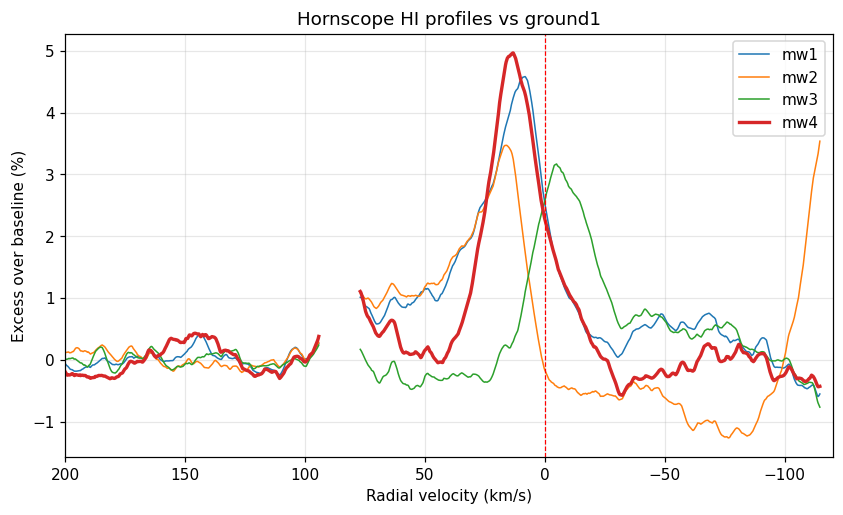
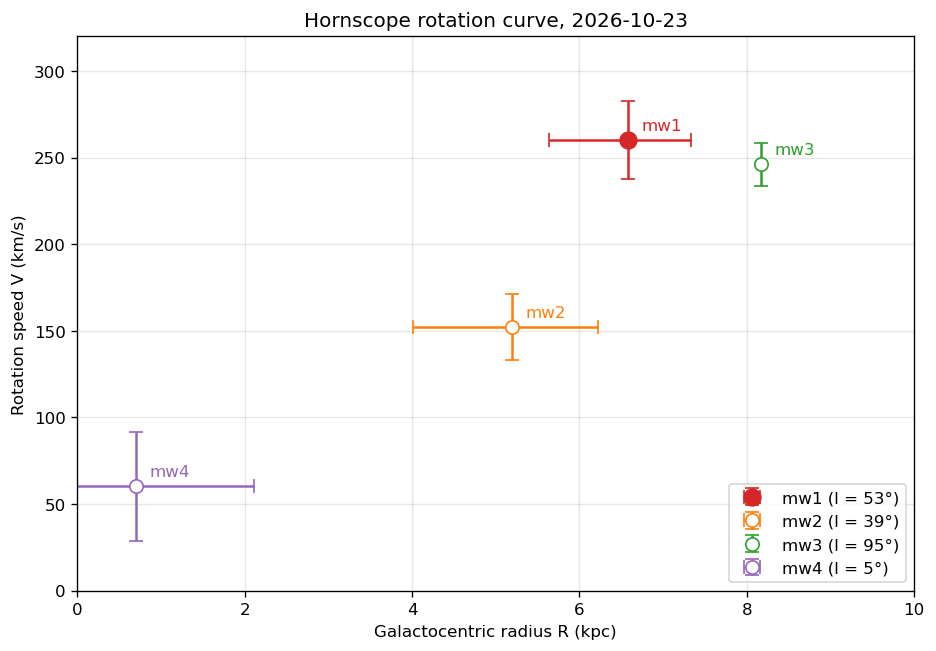

# Hornscope

A low-cost pyramidal horn radio telescope for observing the 21 cm (1420.4 MHz) neutral-hydrogen (HI) line from the Milky Way, built as a course project for **PC5214**.

The horn follows the [DSPIRA](https://wvurail.org/dspira-lessons/) design, and our build and method are modelled on Bhattacharjee, Grover & Arumugam (2026), [*Observations of the 21 cm HI Line from the Milky Way galaxy using Pyramidal Horn Radio Telescope*](https://arxiv.org/abs/2512.19262). Data is recorded and plotted with [Virgo](https://github.com/0xCoto/Virgo).

## Results so far

On **2026-10-23** we detected Galactic HI in four 5-minute pointings and derived a first rotation-curve point.

| Recording | Galactic l, b | HI peak velocity | Notes |
|---|---|---|---|
| mw1 | 53°, +0° | +8 km/s, tail to ~+75 | strong (S/N ≈ 20); gives **V ≈ 250 km/s at R ≈ 6.6 kpc** |
| mw2 | 39°, −10° | +16 km/s | weak (S/N ≈ 5); 10° off the Galactic plane |
| mw3 | 95°, +3° | −5 km/s, tail to ~−50 | outer Galaxy; negative velocities as expected |
| mw4 | 5°, −4° | +13 km/s | toward the Galactic centre; strongest peak |

Only mw1 satisfies the tangent-point method's assumptions (on the plane, 0° < l < 90°, outside the bar). The other points are shown for comparison. See [`analysis/`](analysis/) for details.

## Hardware

| Component | Details |
|---|---|
| Horn | DSPIRA pyramidal geometry; acrylic sheets lined with aluminium foil |
| Waveguide and parts | 3D printed, conductively lined. Models go in [`hardware/3d-prints/`](hardware/3d-prints/) |
| LNA | Nooelec, powered from a USB power bank |
| SDR | Ettus USRP **B200mini-i** (UHD driver) |
| Computer | MacBook running radioconda (GNU Radio, UHD, Virgo) |
| Pointing | Manual; azimuth and altitude recorded for each observation |

Signal chain: **horn → probe → LNA → B200mini (RX2 port) → laptop**

For comparison, the reference horn in the paper has a 75 × 60 cm aperture, 18.5 dBi gain and a ~20° beam at 1420 MHz.

## Observing

See **[OBSERVING.md](OBSERVING.md)** for the step-by-step procedure (setup, ground reference, observation, checking results).

## Repository layout

| Path | Contents |
|---|---|
| [`OBSERVING.md`](OBSERVING.md) | Observing guide |
| [`observations/`](observations/) | Raw recordings (`.dat`, `.header`) with Virgo's plots and CSVs, plus the session log |
| [`analysis/`](analysis/) | Profile comparisons, expected profiles and rotation-curve plots |
| [`tools/observe.py`](tools/observe.py) | Helper for re-plotting and comparing recordings |
| [`hardware/3d-prints/`](hardware/3d-prints/) | 3D-printed part models |

## References

- K. Bhattacharjee, H. Grover, P. Arumugam, *Observations of the 21 cm HI Line from the Milky Way galaxy using Pyramidal Horn Radio Telescope*, J. Astrophys. Astron. 47, 75 (2026). [arXiv:2512.19262](https://arxiv.org/abs/2512.19262)
- DSPIRA: Digital Signal Processing in Radio Astronomy, WVU / NRAO. [Lessons](https://wvurail.org/dspira-lessons/)
- A. Spanakis-Misirlis, [Virgo: an easy-to-use spectrometer and radiometer for radio astronomy](https://github.com/0xCoto/Virgo)
- This repository started as a fork of [WVURAIL/gr-radio_astro](https://github.com/WVURAIL/gr-radio_astro); the GNU Radio code has since been removed.
